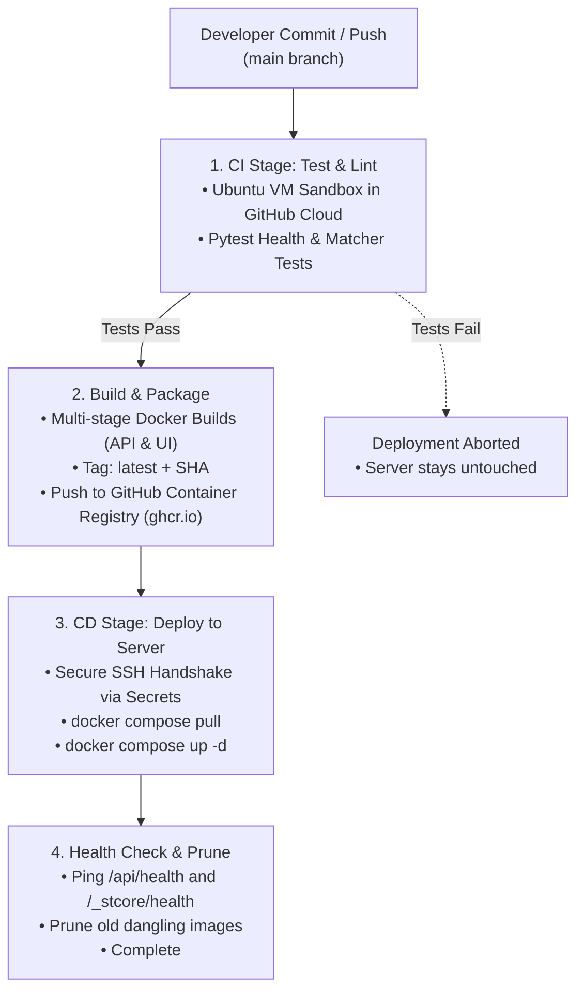

# CI/CD Pipeline and Remote Server Deployment Guide

This directory contains the production CI/CD automation pipeline for the **JobRadar Career Intelligence Platform**. It automates the lifecycle from **code commit**, **fast unit and endpoint testing**, **Docker container packaging**, **GHCR registry publication**, to **zero-downtime SSH server deployment**.

---

## File Structure & Inventory

```text
cicd/
├── .github/workflows/
│   └── deploy.yml            # Main CI/CD: Commit -> Pytest -> Docker Build -> GHCR -> SSH Deploy
├── docker-compose.server.yml # Server compose file configured to pull pre-built GHCR images
├── deploy.sh                 # Standalone bash deployment and health check verification script
└── README.md                 # Complete setup and configuration guide
```

---

## Architecture & Pipeline Flow



---

## Step 1: Configure GitHub Repository Secrets

To allow GitHub Actions to securely connect to your server and GitHub Container Registry, add the following secrets in your repository:

1. Go to your GitHub repository -> **Settings** -> **Secrets and variables** -> **Actions**.
2. Click **New repository secret** and add each secret below:

| Secret Name | Description | Example Value |
| :--- | :--- | :--- |
| `SERVER_HOST` | Public IP or domain name of your Linux server | `159.65.120.45` or `api.yourdomain.com` |
| `SERVER_USER` | SSH login username on your server | `ubuntu`, `root`, or `ec2-user` |
| `SERVER_SSH_KEY` | Private SSH key used to log in to the server | Content of `~/.ssh/id_rsa` or `.pem` file |
| `SERVER_APP_DIR` | Absolute path on your server where the app is located | `/home/ubuntu/jobradar` |
| `GHCR_TOKEN` | GitHub Personal Access Token (Classic) with `read:packages` permission | `ghp_xxxxxxxxxxxxxxxxxxxx` |
| `SERVER_PORT` *(optional)* | Custom SSH Port (defaults to 22) | `22` |

---

## Step 2: Prepare Your Server

Execute the following commands on your Linux server once:

### 1. Enable Non-Sudo Docker Permissions
```bash
sudo usermod -aG docker $USER
newgrp docker
```

### 2. Configure SSH Authentication
On your local machine or server, generate an SSH key if you don't have one:
```bash
ssh-keygen -t rsa -b 4096 -C "github-actions-deploy"
```
Append the **public key** (`id_rsa.pub`) to `~/.ssh/authorized_keys` on your server:
```bash
cat ~/.ssh/id_rsa.pub >> ~/.ssh/authorized_keys
chmod 600 ~/.ssh/authorized_keys
chmod 700 ~/.ssh
```
Copy the **private key** (`id_rsa`) and paste it into GitHub Secret `SERVER_SSH_KEY`.

### 3. Place `.env` and `docker-compose.server.yml` on the Server
In your server's application directory (e.g., `/home/ubuntu/jobradar`):
```bash
mkdir -p /home/ubuntu/jobradar
cd /home/ubuntu/jobradar

# 1. Create your production .env file:
nano .env

# 2. Copy docker-compose.server.yml to the server:
cp cicd/docker-compose.server.yml ./docker-compose.server.yml
```

---

## Step 3: Fast CI Tests

- **Trigger**: Automatic on `git push origin main`.
- **Execution**: Runs in GitHub Cloud (~1 minute).
- **Scope**: Fast Python unit tests in `tests/test_health.py` and `tests/test_matcher.py`, checking endpoint health, authentication gating, and ATS scoring engine logic.

---

## Step 4: Testing the Pipeline

1. **Commit and push changes to GitHub**:
   ```bash
   git add .
   git commit -m "feat: setup automated CI/CD pipeline and docker configs"
   git push origin main
   ```
2. Open your repository on GitHub and click the **Actions** tab.
3. Observe the pipeline progress:
   - `Run Unit & Health Tests` (Tests pass)
   - `Build & Push Docker Images` (Images pushed to `ghcr.io`)
   - `Deploy to Server via SSH` (Server pulls and updates containers)
   - `Health Check Verification` (`/api/health` and `/_stcore/health` return 200 OK)

---

## Step 5: Rollback & Manual Deployment

If you ever need to manually deploy or roll back on the server directly:

```bash
# To run the automated deployment script manually:
chmod +x cicd/deploy.sh
./cicd/deploy.sh

# To roll back to a specific Docker image tag:
docker compose -f docker-compose.server.yml down
docker pull ghcr.io/<your-github-username>/projects/api:<previous-git-sha>
docker pull ghcr.io/<your-github-username>/projects/ui:<previous-git-sha>
docker compose -f docker-compose.server.yml up -d
```
